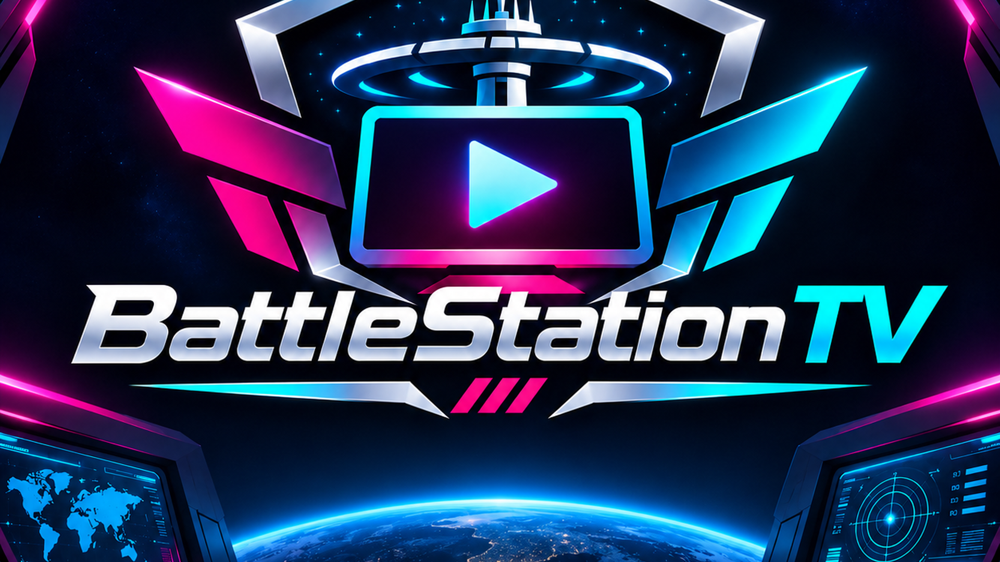

# BattleStation TV

### Your Entertainment Command Center

A customizable, open-source IPTV media player for Windows and Android.

## Official Downloads

[Latest Release](https://github.com/badbubba-10000/BattleStation-TV/releases/latest) |
[All Releases](https://github.com/badbubba-10000/BattleStation-TV/releases) |
[System Requirements](SYSTEM-REQUIREMENTS.md) |
[Installation Guide](INSTALLATION.md)

---

## About BattleStation TV

BattleStation TV is designed to provide a customizable entertainment experience using IPTV sources supplied by the user.

The application is derived from the open-source IPTVMac project and adapted for a distinct Windows and Android entertainment experience.

BattleStation TV is free and does not sell IPTV subscriptions or provide television channels, movies, series, or other streaming content.

## Current Version

- Version: 2.5.0
- Build: 8
- Release name: Automatic Update System
- Distribution: GitHub Releases
- License: GNU General Public License version 3

## Features

### Entertainment

- IPTV account management
- Xtream Codes-compatible sources
- Movie and television series browsing
- Live TV
- Electronic program guide
- Favorites and viewing history
- Media playback controls
- Download management
- DVR and recording functionality, subject to source compatibility

### Customization

- Customizable entertainment dashboard
- Adjustable dashboard widgets
- Multiple interface styles
- Appearance presets
- Theme customization
- Theme import and export
- Customization profiles
- Discoverable appearance unlockables

### Account and Cloud Features

- Optional BattleStation TV account
- Cloud theme backup and restoration
- Multiple theme backup slots
- Local IPTV account management

Cloud functionality requires an internet connection.

### Automatic Updates

Version 2.5.0 introduces an integrated update system designed to:

- Check GitHub for new releases
- Display release information
- Notify users about available updates
- Download compatible installation packages
- Verify downloaded package checksums
- Provide platform-specific installation workflows
- Support manual update checks
- Provide update notification preferences

Public end-to-end update verification requires published releases.

## Supported Platforms

| Platform | Status |
|---|---|
| Windows x64 | Supported build |
| Android phones | Supported build |
| Android tablets | Supported build |
| Android TV | Target platform |
| Google TV | Target platform |
| Android x86-64 emulators | Supported architecture |
| Windows 32-bit | Not supported |
| Android 32-bit | Not supported |
| Apple platforms | Not distributed |
| Roku | Not supported |

Device compatibility may vary.

## Installation

Download installation packages from the official GitHub Releases page.

Windows users should download the Setup.exe package.

Android users should download the APK package.

SHA-256 checksum files are provided to verify package integrity.

See [Installation Instructions](INSTALLATION.md).

## System Requirements

See [System Requirements](SYSTEM-REQUIREMENTS.md) for minimum operating system requirements and recommended hardware specifications.

## Privacy

BattleStation TV is designed without developer-operated advertising or usage analytics.

Optional cloud functionality, IPTV provider communication, and GitHub update checks require network communication.

See [Privacy Information](PRIVACY.md).

## IPTV Disclaimer

BattleStation TV is a media player only.

The application does not provide, host, sell, or distribute IPTV subscriptions or copyrighted entertainment content.

Users are responsible for obtaining authorized media sources and complying with applicable laws and provider terms.

## Open Source and Attribution

BattleStation TV is derived from IPTVMac, originally developed by Goelir and contributors.

Original project:

https://github.com/Goelir/IPTVMac

BattleStation TV modifications are distributed under GPLv3.

Original copyright notices, applicable third-party licenses, and upstream attribution are preserved.

- [GNU GPLv3 License](LICENSE)
- [BattleStation TV Modification Notice](BSTV-NOTICE.md)
- [Third-Party Acknowledgements](flutter/assets/Acknowledgements.md)

BattleStation TV is independently maintained and is not endorsed by the original IPTVMac developers.

## Development

See the [Developer Build Guide](BUILDING.md) for development environment and compilation information.

The application uses Flutter and Dart.

The active Windows and Android source code is located in the flutter directory.

Original upstream platform source may remain in this repository. Its presence does not mean BattleStation TV distributes builds for those platforms.

## Support

Use the GitHub Issues section to report reproducible problems or suggest improvements.

Never include IPTV passwords, account tokens, signing keys, or private information in public issue reports.

## Release History

See [CHANGELOG.md](CHANGELOG.md).

---

**BattleStation TV**

Your Entertainment Command Center

Free. Customizable. Open Source.

